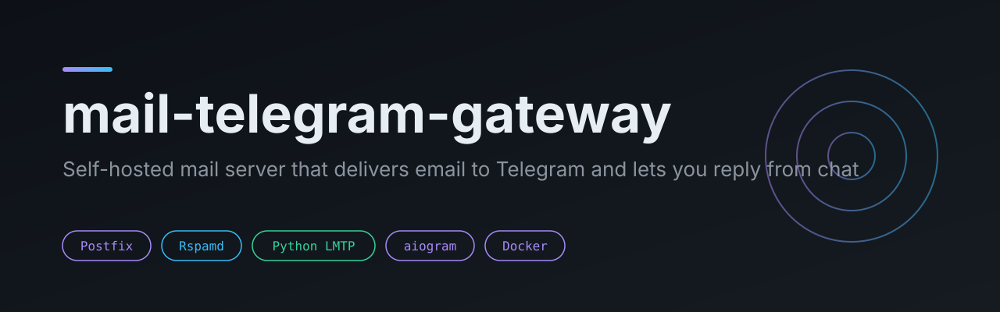
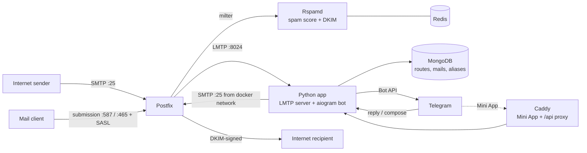

<p align="center"></p>

<p align="center">
  <a href="https://github.com/HurbetAlex/mail-telegram-gateway/actions/workflows/ci.yml"></a>
  
  
  
  
</p>

Self-hosted mail server that delivers incoming email to Telegram and lets you reply, forward and compose from the chat. Postfix accepts mail for your domains, Rspamd filters spam and signs outgoing mail with DKIM, a Python LMTP server parses each message and hands it to an aiogram bot. A Telegram Mini App gives you a mailbox view with search and a compose form.

## What it does

- **Mail to Telegram.** Every message is parsed (headers, text and HTML bodies, attachments, original recipient behind forwards) and sent to the owner of the matching address or domain.
- **Reply from the chat.** Reply (thread is preserved), forward, or write a new message with `/send`: alias picker, attachments, preview. Outgoing mail goes through Postfix and is DKIM-signed by Rspamd.
- **Routing.** Per-domain routes stored in MongoDB, per-subdomain owners from `DOMAIN_OWNERS`, longest-prefix and regex rules on the local part (`+tag` is ignored), catch-all to the admin.
- **Spam is kept, not deleted.** Spam is stored with a `spam` status and stays visible in `/history`.
- **One-time codes.** Codes are extracted from messages and shown as a tap-to-copy button. After `OTP_HIDE_MINUTES` the code is masked in the Telegram message but stays in the database and the Mini App.
- **Search.** `/history` searches subjects, senders and bodies and understands operators such as `from:`, `after:` and `has:`.
- **Aliases.** `/alias name` creates `name@your-domain`, with per-alias counters, a warning when many different sender domains write to one alias, and a disable switch (blocked mail is stored silently).
- **Newsletters.** Bulk mail is detected from `List-Unsubscribe`, `List-Id` and `Precedence`, delivered silently, and gets an Unsubscribe button (RFC 8058 one-click POST over https to public IPs only, then `mailto:`, then the page link).
- **Operations.** Daily digest, health alerts for Postfix, MongoDB, disk, memory and certificates, weekly backup file to Telegram, retention with a grace period and favourites that are never auto-deleted.
- **Mini App.** Inbox, search, read, copy codes, compose, aliases and a server panel, authenticated with Telegram `initData` signatures.

## Architecture



Inbound: SMTP, Postfix, Rspamd, LMTP (Python), Telegram. Outbound from chat: Telegram, the app, Postfix, Rspamd signs, recipient. Mail clients can also submit through Postfix with SASL.

| Service | Role |
|---|---|
| `postfix` | Inbound on 25, submission on 587 and 465 with SASL |
| `rspamd` | Spam filtering through a milter, DKIM signing |
| `redis` | Rspamd backend |
| `mongo` | Collections `routes`, `mails`, `aliases`, `deliveries`, settings |
| `app` | LMTP server and aiogram bot (`src/app`) |
| `web` | Caddy: serves `web/` and proxies `/api` to `app`, automatic Let's Encrypt |
| `backup` | Daily `mongodump` into `./backups` |

## Quickstart

You need a server with a public IPv4, ports 25, 80, 443, 465 and 587 open, Docker with Compose, a domain you control and a Telegram bot token from BotFather.

```bash
git clone https://github.com/HurbetAlex/mail-telegram-gateway.git
cd mail-telegram-gateway
cp .env.example .env                                   # set BOT_TOKEN, ADMIN_ID, domains
cp config/postfix/sasl_users.example config/postfix/sasl_users   # SMTP AUTH users
# edit config/postfix/main.cf (myhostname, mydomain, virtual_mailbox_domains)
# edit config/postfix/sender_login (which login may send from which address)
docker compose up -d --build
./scripts/setup-dkim.sh                                # prints the DKIM TXT records
```

DNS for `example.com` (replace with your domain and IP):

| Record | Value |
|---|---|
| `A` `mail.example.com` | `203.0.113.10` |
| `MX` `example.com` | `10 mail.example.com` |
| `TXT` `example.com` | `v=spf1 mx -all` |
| `TXT` `mail._domainkey.example.com` | printed by `setup-dkim.sh` |
| `TXT` `_dmarc.example.com` | `v=DMARC1; p=quarantine; rua=mailto:postmaster@example.com` |
| `PTR` for the server IP | `mail.example.com` (set at your hosting provider) |

Check delivery with `swaks --to test@example.com --server localhost:25`, then open `https://mail.example.com/` and set `WEBAPP_URL=https://mail.example.com/` in `.env` to switch the "Compose" button from chat dialogs to the Mini App (`docker compose up -d app`).

To give another person their own subdomain: add the subdomain to `virtual_mailbox_domains`, add `subdomain:telegram_id` to `DOMAIN_OWNERS`, add their login to `sender_login` and `sasl_users`, run `scripts/setup-dkim.sh` for the new domain (or rely on parent-domain signing, which DMARC accepts with relaxed alignment).

## Bot commands

Access is limited to `ADMIN_ID` and the owners listed in `DOMAIN_OWNERS`.

| Command | Purpose |
|---|---|
| `/send` | New message: alias, recipients, attachments, preview |
| `/history [text]` | Recent mail, search over bodies too |
| `/starred` | Favourites (protected from retention cleanup) |
| `/unassigned` | Mail without a route, with a "mine" button |
| `/stats` | Counts by status |
| `/add_route` `/add_domain` `/del_route` `/list_routes` | Routing rules |
| `/alias` `/aliases` | Create and manage aliases |
| `/whereis text` | Which address received mail from a sender |
| `/mute` `/rules` | Per-sender rules |
| `/template_add` `/templates` | Reply templates |
| `/cancel` | Abort the current dialog |

## Configuration

Set in `.env` (see `.env.example`). The main variables:

| Variable | Default | Purpose |
|---|---|---|
| `BOT_TOKEN` | required | Telegram bot token |
| `ADMIN_ID` | required | Telegram ID of the owner |
| `MAIL_DOMAIN` | `example.com` | Main domain, used for the admin's addresses |
| `DOMAIN_OWNERS` | empty | `domain:telegram_id` pairs for per-person subdomains |
| `GUEST_ID`, `GUEST_DOMAIN` | empty | Single extra owner (older alternative to `DOMAIN_OWNERS`) |
| `MAIL_SIGNATURE` | empty | Signature appended to outgoing mail |
| `MAIL_TTL_DAYS` | `180` | Retention in days, `0` disables cleanup |
| `CLEANUP_TIME`, `CLEANUP_GRACE_DAYS` | `04:30`, `3` | Daily cleanup time, delay between the first warning and the first deletion |
| `WEBAPP_DOMAIN`, `WEBAPP_URL` | see file | Mini App domain for Caddy and the URL for the bot button |
| `DIGEST_TIME`, `DIGEST_TZ` | `09:00`, `Europe/Kyiv` | Daily digest, empty time disables it |
| `HEALTH_CHECK_MINUTES` | `5` | Health check period, `0` disables alerts |
| `DISK_ALERT_PCT`, `MEM_ALERT_MB`, `SWAP_ALERT_PCT`, `CERT_ALERT_DAYS` | `90`, `100`, `85`, `14` | Alert thresholds |
| `BACKUP_KEEP_DAYS` | `14` | How long `mongodump` archives are kept |
| `BACKUP_TG_WEEKDAY`, `BACKUP_TG_TIME` | `6`, `05:00` | Weekly backup file sent to Telegram |
| `BLOB_*` | see file | Limits for stored HTML and attachments |
| `OTP_HIDE_MINUTES` | `15` | Mask one-time codes after N minutes, `0` is off |

## Testing

```bash
pip install -r requirements-dev.txt
python -m pytest -q          # 219 tests
```

Tests cover message and header parsing, original-recipient detection behind forwards, one-time code extraction and masking, search operator parsing, access rules, unsubscribe URL validation (including SSRF guards), from-address selection, the Mini App API (auth, routes, parity with the bot) and server status checks. They run without Docker, Telegram or MongoDB. CI runs the suite and a shell syntax check on the scripts.

## Project structure

```text
config/
  postfix/          main.cf, master.cf, entrypoint, sender_login, Dockerfile
  rspamd/local.d/   DKIM signing, greylisting, milter headers, Redis
  caddy/            Caddyfile for the Mini App and API proxy
  fail2ban/         SASL brute-force filter and jail
scripts/            deploy, DKIM setup, fail2ban setup, status exporter
src/app/
  mail/             LMTP server, composer, SMTP sender, blob store, unsubscribe
  bot/              aiogram handlers, compose dialogs, access control, OTP masking
  web/              aiohttp API behind the Mini App
  db/               MongoDB storage layer
  utils/            parser, headers, search, settings
  monitor.py        digest, health checks, cleanup, backup notifications
web/                Mini App (HTML, CSS, JS)
tests/              pytest suite
docker-compose.yml  postfix, rspamd, redis, mongo, app, web, backup
```

## Security notes

- **Sender authentication.** Outgoing mail is signed by Rspamd (DKIM, selector `mail`). Publish SPF, DKIM and a DMARC policy as shown above and set a PTR record.
- **Spam filtering.** Rspamd runs as a milter in front of delivery, with greylisting. Spam is stored, never silently dropped.
- **Owner-only bot.** Only `ADMIN_ID` and listed domain owners can use the bot. A non-admin sees only the mail that belongs to them.
- **Mini App auth.** Each API request carries Telegram `initData`, verified with an HMAC derived from the bot token and rejected after 24 hours.
- **SMTP AUTH hardening.** Postfix rate limits authentication attempts per IP, `sender_login` ties each SASL login to its allowed From addresses, and the bundled fail2ban filter bans IPs after repeated failed logins.
- **Unsubscribe safety.** One-click unsubscribe only calls https URLs that resolve to public IPs, without following redirects. `mailto:` targets are strictly validated.
- **Secrets.** `.env`, `sasl_users`, DKIM keys and backups are git-ignored. The example files contain placeholders only.
- **Forged reply sender.** The From address of a reply or forward is checked against the user's own addresses before sending. The To header of an incoming mail is never trusted as a sender.
- **Forged filter headers.** Postfix strips incoming `X-Spam-*`, `X-Spamd-*`, `X-Rspamd-*` and `Authentication-Results` headers before Rspamd adds its own, and the app marks a mail as spam if any `X-Spam-Status` header says Yes.
- **Allow rules need authentication.** An "allow" rule for a sender takes effect only when Rspamd reports `dmarc=pass` or an aligned `dkim=pass` for the From domain; otherwise the spam verdict stands.
- **Insert-only storage.** A stored mail is never overwritten. Deduplication uses a hash of the raw message plus the recipient, not the sender-controlled Message-ID, and blobs of existing mails are left alone.
- **TLS before AUTH.** `smtpd_tls_auth_only = yes`: SMTP AUTH is offered only after STARTTLS.
- **Known limits.** Mail is stored unencrypted in MongoDB, and the default Postfix TLS setting for mail exchange is opportunistic. Terminate trust at the host level (disk encryption, firewall) and review `main.cf` before exposing the server.

## Roadmap

- [ ] Replace the self-signed Postfix certificate with the Let's Encrypt certificate that Caddy already obtains
- [ ] Optional encryption at rest for message bodies
- [ ] Integration tests with a real Postfix container in CI
- [ ] Per-user rate limits for outgoing mail
- [ ] Packaged image for the app service instead of a bind-mounted `src/`

## License

MIT, see [LICENSE](LICENSE).
